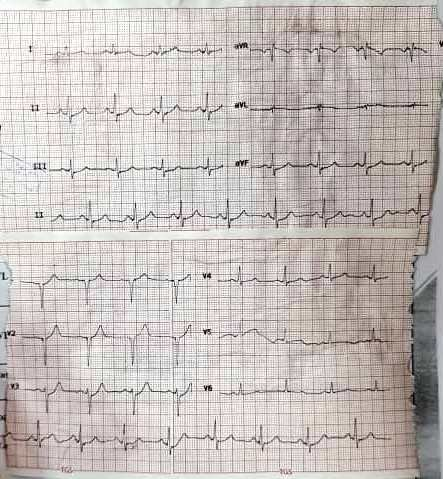

# 🫀 جزوهٔ کامل ECG — از زبان دکتر زادکمالی

## کاردیولوژیست / الکتروفیزیولوژیست — دورهٔ فیزیوپاتولوژی

> **این جزوه چه چیزی است؟** روایتِ کاملِ ۳۲ دقیقه و ۷ ثانیه صدای استاد، قطعه‌به‌قطعه و
> بی‌جاافتادگی، همراه با **متن دقیق همان اسلاید** که در حین صحبت روی پرده بوده است.
> هیچ قطعهٔ صوتی‌ای حذف نشده و هیچ بخشی از سخن استاد بدون پوشش نمانده است.
> **۳۴ تصویر اسلایدها** هم در جای مناسب هر بخش (و پیوست الف-۲) جاسازی شده‌اند.

### 🔑 راهنمای خواندن

| نشان | معنا |
|---|---|
| 🎙 **استاد گفت** | بازسازیِ پاک‌سازی‌شدهٔ سخن استاد — وفادار به صدا، با کمک متن اسلاید فقط برای رفع ابهامِ اصطلاحات |
| 📊 **اسلاید** | متن **دقیق و بدون دخل‌وتصرف** همان اسلاید (از XML خود فایل pptx خوانده شده) |
| 📌 **برداشت** | توضیح تکمیلی و جمع‌بندی — از متن اسلاید و دانش تخصصی، نه از صدای استاد |
| ⏱ | زمان شروع قطعه در نوار ۳۲ دقیقه‌ای + شمارهٔ قطعه و اسلاید |
| 📷 | تصویر **خودِ اسلاید** (استخراج‌شده از فایل pptx) با توضیح فارسی |

### 🚦 نشان درجهٔ اطمینان هر بخش

| نشان | معنا |
|---|---|
| 🟢 | صدای استاد در این بخش **روان و قابل‌فهم** پیاده شده — بازسازی، بسیار وفادار |
| 🟡 | بخشی از کلمات با کمک متن اسلاید بازسازی شده — محتوا درست، ولی جمله‌ها آزادترند |
| 🔴 | صدا برای مدلِ موجود **ناخوانا** بود؛ فقط خطِ کلیِ مطلب از صدا گرفته شده و شرح از اسلاید است |

> **شفافیت کامل:** هیچ مدل فارسیِ بهتری از داخل این محیط قابل دریافت نبود (تمام مسیرها در
> `asr-accuracy.md` فهرست شده). برای جبران، هر قطعه با **۶ جریان مستقل تشخیص گفتار** پیاده
> و واژه‌به‌واژه رأی‌گیری شد؛ **۹۰٫۵٪ واژه‌ها تأیید ≥۲ جریان** دارند. با این حال این جزوه
> «نقل‌قولِ کلمه‌به‌کلمه» نیست؛ برای استناد، فایل صوتی (پوشهٔ `audio/`) را بشنوید.
> متن خامِ بدون بازسازی: `transcript-fa-v3.md`.

---

## فهرست

۱. [شروع درس](#۱) · ۲. [ECG چیست و چه فایده‌ای دارد](#۲) · ۳. [پایهٔ فیزیکی: چرا موج مثبت یا منفی؟](#۳)
۴. [نمای کلی ۱۲ لید](#۴) · ۵. [الکترودهای اندامی و ترتیب رنگ‌ها](#۵) · ۶. [لیدهای دو-قطبی](#۶)
۷. [لیدهای پرشی و محل دقیق الکترودها](#۷) · ۸. [زوایای مختلف نگاه به قلب](#۸) · ۹. [محور: مفهوم و بردار](#۹)
۱۰. [امواج، سگمنت‌ها و فواصل](#۱۰) · ۱۱. [استاندارد ثبت: سرعت، گین، کالیبراسیون](#۱۱) · ۱۲. [ریتم سینوسی](#۱۲)
۱۳. [محاسبهٔ ضربان قلب](#۱۳) · ۱۴. [برادی‌کاردی](#۱۴) · ۱۵. [تاکی‌کاردی](#۱۵) · ۱۶. [محور: الگوریتم بالینی](#۱۶)
۱۷. [لیدهای همجوار](#۱۷) · ۱۸. [موج P](#۱۸) · ۱۹. [بزرگی دهلیزها](#۱۹) · ۲۰. [فاصلهٔ PR](#۲۰)
۲۱. [PR کوتاه و سندرم WPW](#۲۱) · ۲۲. [توالی دپلاریزاسیون بطن](#۲۲) · ۲۳. [نام‌گذاری کمپلکس QRS](#۲۳)
۲۴. [شش پارامتر ارزیابی QRS](#۲۴) · ۲۵. [محور نرمال و انحراف‌ها](#۲۵) · ۲۶. [پیشرفت موج R](#۲۶)
[پیوست الف: اسلایدهای ۳۷–۶۶](#الف) · [پیوست ب: فرمول‌ها و جدول‌ها](#ب) · [پیوست پ: واژه‌نامه](#پ) · [پیوست ت: شفافیت و روش](#ت)

---

<a id="۱"></a>
## ۱) شروع درس
`⏱ 00:00 — قطعهٔ ۱ · اسلاید ۱` · 🟡

> 🎙 **استاد گفت:**
> «با سلام؛ بحث را برای درس **فیزیوپاتولوژی** شروع می‌کنیم.»

> 📊 **اسلاید ۱ (متن دقیق):** ECG · Dr M. Zadkamali · Cardiologist / Electrophysiologist

**📌 برداشت:** شروع دوره، معرفی موضوع: **الکتروکاردیوگرافی**.

---

<a id="۲"></a>
## ۲) ECG چیست و چه فایده‌ای دارد
`⏱ 00:09 — قطعهٔ ۲ · اسلاید ۲` · 🟢

> 🎙 **استاد گفت:**
> «الکتروکاردیوگرافی روشی است که **فعالیت الکتریکال قلب** را از **طریق پوست** ثبت می‌کند؛
> آن‌چه دیده می‌شود، روی **کاغذ** ثبت می‌شود. روشی است **غیرتهاجمی**، **به‌آسانی در دسترس**
> و **کم‌هزینه** و فواید بسیاری دارد.
> برای تشخیص **بیماری‌های ایسکمیک قلبی**، **آریتمی‌ها**، **بیماری‌های ساختاری قلب** و
> همچنین **بیماری‌های سیستمیک** کمک‌کننده است؛ و برای تشخیص بعضی مسائل مربوط به
> **سایر ارگان‌ها** — مثل **مسائل متابولیک** — هم می‌تواند کمک کند.»

> 📊 **اسلاید ۲ (متن دقیق):** Transcutaneous recording of cardiac electrical activity · Non-invasive · Easily available · Cost-effective · Several advantages · For diagnosis of ischemia, arrhythmias, structural heart diseases, metabolic diseases…

**📌 برداشت — چهار ستون ارزش ECG:**

| ویژگی | یعنی چه؟ |
|---|---|
| **Transcutaneous** | ثبت از روی پوست؛ چیزی وارد بدن نمی‌شود |
| **Non-invasive** | بی‌خطر، تکرارپذیر، بدون عارضه |
| **Easily available** | در هر درمانگاه و اورژانس، در چند دقیقه |
| **Cost-effective** | ارزان‌ترین ابزار تشخیصی قلب |

کاربردها: **ایسکمی/انفارکتوس** · **آریتمی** · **بیماری ساختاری** · **اختلالات متابولیک و الکترولیتی** (مثل هیپرکالمی).

---

<a id="۳"></a>
## ۳) پایهٔ فیزیکی: چرا موج مثبت یا منفی ثبت می‌شود؟
`⏱ 01:01 — قطعهٔ ۳ · اسلاید ۳` · 🟡

> 🎙 **استاد گفت:**
> «ECG حاصل ثبت **فعالیت الکتریکال میوکارد** است — **در سطح سلولی**. وقتی موج
> **دپلاریزاسیون به سمت الکترود مثبت** می‌آید، موج **مثبت** ثبت می‌شود؛ و اگر
> **از الکترود مثبت دور** شود، موج **منفی** ثبت می‌شود.»

> 📊 **اسلاید ۳ (متن دقیق):** *(شکل — بدون متن؛ همان شکل سطح سلولی و جهت بردار)*

> 📊 **اسلاید ۱۰ (متن دقیق):** Vector of each lead is depicted from **negative to positive electrode**

**📌 برداشت — قانون طلایی نوار قلب:**

```
موج به سمت الکترود مثبت  →  انحراف رو به بالا (مثبت)  ↑
موج در جهت مخالف        →  انحراف رو به پایین (منفی)  ↓
```

همین یک قاعده، توضیح‌دهندهٔ همهٔ شکل‌های طبیعی و پاتولوژیک ECG است: **لیدها فقط «دوربین»هایی با زاویهٔ متفاوت‌اند** و آنچه تغییر می‌کند، **جهت بردار نسبت به آن دوربین** است.


---

<a id="۴"></a>
## ۴) نمای کلی ۱۲ لید
`⏱ 01:37 — قطعهٔ ۴ · اسلاید ۴` · 🟡

> 🎙 **استاد گفت:**
> «این نمای کلی چیزی است که در **ECG استاندارد** می‌بینیم. ECG استاندارد **۱۲ لید** دارد:
> **۶ لید اندامی** به نام‌های **یک، دو، سه** و **aVR، aVL و aVF**؛ و **۶ لید پرشی**
> که از **V1 تا V6** نام‌گذاری می‌شوند. در ادامه اشاره می‌کنیم که این لیدهای مختلف
> چگونه ثبت می‌شوند.»

> 📊 **اسلاید ۵ (متن دقیق):** 12 leads in surface ECG · 6 limb leads · 6 precordial

**📌 برداشت — نقشهٔ ۱۲ لید:**

| گروه | لیدها | صفحهٔ نگاه |
|---|---|---|
| **اندامی دو-قطبی** | I، II، III | فرونتال |
| **اندامی تقویت‌شده** | aVR، aVL، aVF | فرونتال |
| **پرشی (سینه‌ای)** | V1 … V6 | هورایزنال (افقی) |


---

<a id="۵"></a>
## ۵) الکترودهای اندامی و ترتیب رنگ‌ها
`⏱ 02:11 — قطعهٔ ۵ · اسلاید ۶` · 🟡

> 🎙 **استاد گفت:**
> «برای تهیهٔ لیدهای اندامی به **چهار الکترود** احتیاج داریم که به **دیستال** دو اندام
> فوقانی و دو اندام تحتانی وصل می‌شوند. اگر به هر دلیلی انتهای اندام **قابل دسترس نبود**
> — یا بیمار **نقص عضو** داشت — امکان دیگری هست: می‌شود الکترودها را به **بخش پروکسیمال**
> اندام یا **محل اتصال اندام به تنه** وصل کرد.
> ترتیب رنگ‌ها: **قرمز = دست راست**، **زرد = دست چپ**، **سبز = پای چپ** و
> **مشکی = پای راست**.»

> 📊 **اسلاید ۶ (متن دقیق):** Limb electrodes

| رنگ | اندام | یادسپار |
|---|---|---|
| 🔴 **قرمز** | دست راست | Red → Right |
| 🟡 **زرد** | دست چپ | Yellow → Left |
| 🟢 **سبز** | پای چپ | Green → پای چپ |
| ⚫ **مشکی** | پای راست | Black → Right leg (سیم زمین) |

> 💡 **نکتهٔ عملی:** در بیمار **قطع عضو** یا **سرم‌گذاری‌شده**، الکترود را روی **استامپ پروکسیمال** یا تنه می‌بندند؛ شکل موج کمی تغییر می‌کند ولی ریتم و بیشتر پارامترها خوانا می‌ماند.

---

<a id="۶"></a>
## ۶) لیدهای دو-قطبی (I، II، III)
`⏱ 03:19 — قطعهٔ ۶ · اسلاید ۷` · 🟡

> 🎙 **استاد گفت:**
> «برای لیدهای دو-قطبی، **دو الکترود مثبت و منفی** لازم است:
> اگر **منفی روی دست راست** و **مثبت روی دست چپ** باشد، **لید یک** ایجاد می‌شود؛
> اگر **منفی روی دست راست** و **مثبت روی پای چپ**، **لید دو**؛
> و اگر **منفی روی دست چپ** و **مثبت روی پای چپ**، **لید سه**.»

> 📊 **اسلاید ۷ (متن دقیق):** Bipolar leads

| لید | قطب منفی | قطب مثبت | جهت نگاه |
|---|---|---|---|
| **I** | دست راست | دست چپ | جانبی (لاترال) |
| **II** | دست راست | پای چپ | تحتانی — **لید پایش ریتم** |
| **III** | دست چپ | پای چپ | تحتانی |

> 💡 **چرا لید II برای پایش؟** تقریباً **موازی محور طبیعی قلب** است؛ به همین دلیل **موج P** در آن واضح‌ترین شکل را دارد.

> 📊 **اسلاید ۸ (متن دقیق):** Augmented (unipolar) limb leads — aVR، aVL، aVF (تقویت‌شده، نسبت به یک قطب مرجع)

---

<a id="۷"></a>
## ۷) لیدهای پرشی و محل دقیق الکترودها
`⏱ 03:51 — قطعهٔ ۷ · اسلاید ۹` + `⏱ 04:34 — قطعهٔ ۸ · اسلاید ۹` · 🔴/🟡

> 🎙 **استاد گفت (بازسازی از قطعهٔ ۷ و ۸):**
> «**شش لید پرشی** نداریم… الکترودها در **فضای بین‌دنده‌ای** و در **یک سطح افقی** دور
> قفسهٔ سینه قرار می‌گیرند: **V1 و V2** در فضای بین‌دنده‌ای **چهارم**، کنار جناغ راست و چپ؛
> **V3** بین V2 و V4؛ **V4** در فضای بین‌دنده‌ای **پنجم** در **خط میان‌ترقوه‌ای چپ**؛
> **V5 و V6** در همان سطح، به‌طرف **خط زیربغل قدامی و میانی**.
> در بحث ایسکمی اشاره خواهد شد که در بیمارانی که مشکوک به **MI** هستند — به‌ویژه
> **انفارکتوس خلفی** — لازم است **لیدهای دیگری** هم بگیریم: **V7، V8 و V9** در همان سطح
> افقی، در سمت **چپ و پشت** مهره‌ها قرار می‌گیرند. هم‌چنین در بیماری که
> **هایپرتروفی** قابل ملاحظه دارد، ویژگی‌های **دوازده لید** را می‌بینیم.
> **V1 تا V6** هم به‌صورت **قرینه** در سمت راست قرار داده می‌شوند (**V3R تا V6R**) — این
> در بعضی موقعیت‌ها که بخواهیم سمت راست را ببینیم انجام می‌شود.»

> 📊 **اسلاید ۹ (متن دقیق):** Precordial leads

| لید | محل |
|---|---|
| **V1** | فضای بین‌دنده‌ای چهارم، **کنار جناغ راست** |
| **V2** | فضای بین‌دنده‌ای چهارم، **کنار جناغ چپ** |
| **V3** | بین V2 و V4 |
| **V4** | فضای بین‌دنده‌ای پنجم، **خط میان‌ترقوه‌ای چپ** |
| **V5** | همان سطح V4، **خط زیربغل قدامی** |
| **V6** | همان سطح V4/V5، **خط زیربغل میانی** |

| لیدهای تکمیلی | کاربرد |
|---|---|
| **V3R–V6R** | نگاه به **بطن راست** (مثلاً MI رانتی) |
| **V7–V9** | نگاه به **دیوارهٔ خلفی** |

> 💡 **حیاتی‌ترین دقت این بخش:** V1 و V2 در **فضای بین‌دنده‌ای چهارم** قرار می‌گیرند؛ اشتباه در این محل، الگوهای کاذب مثل «R بلند در V1» یا اختلال کاذب در **پیشرفت موج R** تولید می‌کند.

---

<a id="۸"></a>
## ۸) زوایای مختلف نگاه به قلب
`⏱ 05:51 — قطعهٔ ۹ · اسلاید ۱۰` · 🟡

> 🎙 **استاد گفت:**
> «لیدها **دوربین‌های** از زوایای مختلف‌اند که به **فعالیت الکتریکی قلب** نگاه می‌کنند:
> لیدهای **اندامی** در **مقطع فرونتال** (نما) و لیدهای **پرشی** در **مقطع هورایزنال**.»

> 📊 **اسلاید ۱۰ (متن دقیق):** Vector of each lead is depicted from **negative to positive electrode**

**📌 برداشت:** اگر یک بردار در جهت یک لید باشد، بیشترین انحراف را در آن لید می‌سازد و **لیدهای عمود بر آن** کم‌ترین انحراف را دارند. همین موضوع، پایهٔ **تعیین محور** (بخش ۹) است.


---

<a id="۹"></a>
## ۹) محور: مفهوم و بردار
`⏱ 06:16 — قطعهٔ ۱۰ · اسلاید ۱۱` · 🟡

> 🎙 **استاد گفت:**
> «یک موضوع به‌عنوان **محور (axis)** مطرح است، بر اساس اینکه **جهت بردار الکتریکی قلب**
> — و آن **حداکثر مقدارش** — **هم‌راستا با کدام یک از لیدها** باشد.
> در شکلی که ملاحظه می‌کنید، اگر بردار **هم‌راستا با لید یک** باشد، محور **صفر درجه** است؛
> اگر با **لید دو** باشد حدود **۶۰ درجه** — و در جهت مخالف، منفی ۳۰ درجه؛
> اگر **هم‌راستا با aVF** باشد حدود **۹۰ درجه**؛ و اگر برعکسش باشد، حدود **۲۱۰-** درجه.
> اگر هم‌راستای **aVL** باشد ۱۲۰ درجه…»

> 📊 **اسلاید ۱۱ (متن دقیق):** *(شکل دایرهٔ لیدها و محورها)*

**📌 برداشت — جدول مرجع محور:**

| لید (جهت بردار) | زاویهٔ محور |
|---|---|
| **I** | ۰° |
| **II** | ۶۰° |
| **aVF** | ۹۰° |
| **III** | ۱۲۰° |
| **aVL** | ۳۰-° |
| **aVR** | ۱۵۰-° (یا ۲۱۰-) |


---

<a id="۱۰"></a>
## ۱۰) امواج، سگمنت‌ها و فواصل
`⏱ 07:24 — قطعهٔ ۱۱ · اسلاید ۱۳` + `⏱ 07:53 — قطعهٔ ۱۲ · اسلاید ۱۳` · 🔴

> 🎙 **استاد گفت (قطعهٔ ۱۱ و ۱۲):**
> «اجزایی داریم: **امواج**، **سگمنت‌ها** و **فواصل**. **سگمنت** بخشی از خط **ایزوالکتریک**
> (خط پایه) است که بین دو موج قرار می‌گیرد؛ ولی **فاصله (interval)** از شروع یک موج
> تا شروع موج بعدی است و **شامل یک موج هم** می‌شود.
> **موج P** مربوط به فعالیت الکتریکی و **دپولاریزاسیون دهلیزها** است؛ **کمپلکس QRS**
> مربوط به **دپولاریزاسیون بطن‌ها**؛ و **موج T** مربوط به **رپولاریزاسیون بطن‌ها**.»

> 📊 **اسلاید ۱۲ (متن دقیق):** Waves, segments, intervals
> 📊 **اسلاید ۱۳ (متن دقیق):** *(شکل)*

**📌 برداشت — این جدول را حفظ کنید:**

| جزء ECG | رخداد الکتریکی |
|---|---|
| **موج P** | دپولاریزاسیون **دهلیزها** |
| **کمپلکس QRS** | دپولاریزاسیون **بطن‌ها** |
| **موج T** | رپولاریزاسیون **بطن‌ها** |
| **فاصلهٔ PR** | از شروع P تا شروع QRS (شامل تأخیر AV) |
| **سگمنت ST** | از پایان QRS تا شروع T |

| تفاوت | سگمنت | فاصله (interval) |
|---|---|---|
| تعریف | بین **دو موج** | **شامل یک موج** |
| مثال | ST، PR | QT، RR |


---

<a id="۱۱"></a>
## ۱۱) استاندارد ثبت: سرعت، گین، کالیبراسیون
`⏱ 08:13 — قطعهٔ ۱۳ · اسلاید ۱۴` · 🟢

> 🎙 **استاد گفت:**
> «کنار هر نوار، **شاخصی** هست که با شکل خاصی نمایش داده می‌شود؛ به آن **scale** می‌گوییم.
> **دو مؤلفهٔ مهم** دارد: یکی **سرعت حرکت کاغذ** و دیگری **ولتاژ (گین)**.
> **سرعت استاندارد ۲۵ میلی‌متر بر ثانیه** و **گین ۱۰ میلی‌متر بر میلی‌ولت** است.
> اگر با گین و سرعت استاندارد ثبت شده باشد، همان **نمای استاندارد** را می‌بینیم.
> اگر به هر دلیلی **ولتاژ و گین کاهش** پیدا کند، تمام امواج **فشرده** می‌شوند و تغییرات
> **خفیف‌تر** دیده می‌شود؛ برعکس اگر **گین افزایش** پیدا کند، **اندازهٔ امواج بزرگ‌تر**
> دیده می‌شود.
> در مورد **سرعت** هم همین‌طور است: اگر دستگاه با **سرعت بالاتر** کاغذ را حرکت دهد،
> **فاصلهٔ بین کمپلکس‌ها بیشتر** می‌شود و اگر با **سرعت کمتر**، فاصله‌ها **کمتر** می‌شود.
> **بهترین حالت این است که حالت غیراستاندارد را هم بدانیم** — چون اگر روی نوار نوشته شده
> باشد که با چه سرعت و گینی ثبت شده، قضاوت درست می‌کنیم. بعضی وقت‌ها اندازه‌ها را برحسب
> **خانه‌های کوچک** می‌گویند؛ اگر با استاندارد مطابقت داده شود، معنا روشن است.»

> 📊 **اسلاید ۱۴ (متن دقیق):** Standard · Speed: 25 mm/sec · Gain: 10 mm/mV · Calibration

| پارامتر | مقدار استاندارد | معادل |
|---|---|---|
| **سرعت کاغذ** | ۲۵ mm/s | هر خانهٔ کوچک = **۰٫۰۴ ثانیه** · هر خانهٔ بزرگ = **۰٫۲ ثانیه** |
| **گین** | ۱۰ mm/mV | ۱ mV = ۱۰ mm = **۲ خانهٔ بزرگ** |
| **کالیبراسیون** | پالس ۱ mV | باید ابتدای نوار دیده شود (دو خانهٔ بزرگ) |

**📌 اثر تغییر گین و سرعت روی شکل موج:**

| اتفاق | روی **ارتفاع** | روی **عرض / فاصله‌ها** |
|---|---|---|
| **گین ↓** | امواج **کوتاه‌تر** | بی‌تأثیر |
| **گین ↑** | امواج **بلندتر** | بی‌تأثیر |
| **سرعت ↑** | بی‌تأثیر | فاصلهٔ کمپلکس‌ها **بیشتر** |
| **سرعت ↓** | بی‌تأثیر | فاصله‌ها **کمتر** |

> 💡 **هشدار بالینی:** «گین پایین» می‌تواند **آمپلی‌تودِ واقعاً کوچک** (مثل ولتاژ پایین در افیوژن پریکارد) را پنهان کند یا برعکس، **هایپرتروفی کاذب** بسازد. همیشه اول **سرعت، گین و کالیبراسیون** را چک کنید.

---

<a id="۱۲"></a>
## ۱۲) ریتم سینوسی
`⏱ 11:08 — قطعهٔ ۱۴ · اسلاید ۱۵` · 🟢

> 🎙 **استاد گفت:**
> «پس از این‌که به ضربان رسیدیم، سراغ **ریتم** بیمار می‌رویم. برای تشخیص ریتم، اولین
> کار این است که ببینیم **منشأ P** از **گرهٔ سینوسی (SA node)** هست یا نه.
> اگر P از SA باشد، **ریتم سینوسی** است. ویژگی‌اش این است که **در لید دو مثبت** و
> **در aVR منفی** است. در ریتم سینوسی باید برای **هر QRS یک کمپلکس P** وجود داشته باشد
> و **ارتباط P با QRS برقرار** باشد.
> در مواقعی که **QRS فرم دیگری** دارد و **ارتباط بین P و QRS برقرار نیست**، ریتم سینوسی
> نیست؛ ریتم دیگری است که در بحث **آریتمی‌ها** با جزئیات بیشتر توضیح داده خواهد شد.»

> 📊 **اسلاید ۱۵ (متن دقیق):** Sinus · … · Rhythm

**📌 معیارهای چهارگانهٔ ریتم سینوسی:**

1. **موج P مثبت در لید II** و **منفی در aVR**
2. برای **هر QRS** یک **P** — با فاصلهٔ **PR ثابت**
3. فاصلهٔ **RR منظم**
4. ضربان **۶۰ تا ۱۰۰**



---

<a id="۱۳"></a>
## ۱۳) محاسبهٔ ضربان قلب
`⏱ 12:22 — قطعهٔ ۱۵ · اسلاید ۱۶` + `⏱ 14:25 — قطعهٔ ۱۶ · اسلاید ۱۷` · 🟢

> 🎙 **استاد گفت:**
> «اول نگاه می‌کنیم ببینیم **ریتم منظم** است یا **نامنظم**.
> اگر **منظم** باشد و فاصلهٔ کمپلکس‌ها **ثابت** باشد، **تعداد خانه‌های بزرگ** بین دو
> کمپلکس را می‌شماریم و **۳۰۰ را تقسیم بر آن عدد** می‌کنیم؛ مثلاً اگر فاصله **چهار
> خانهٔ بزرگ** باشد، به عدد **۷۵** می‌رسیم.
> اگر ضربان **خیلی بالا** باشد — یعنی فاصلهٔ کمپلکس‌ها **خیلی کم** باشد — **تعداد
> خانه‌های کوچک** را می‌شماریم و **۱۵۰۰ را تقسیم بر آن** می‌کنیم؛ دقیق‌تر هم هست.
> اگر **نامنظم** باشد، باید **تعداد کمپلکس‌های QRS در یک بازهٔ طولانی‌تر — مثلاً
> ۶ ثانیه —** را بشماریم و در **۱۰** ضرب کنیم؛ یا در **۱۰ ثانیه** بشماریم و در **۶** ضرب کنیم.»

> 🎙 **استاد گفت (مثال بیمار — قطعهٔ ۱۶):**
> «این نمونهٔ یک بیمار است. فواصل QRS **منظم** است، پس از فرمول **۱۵۰۰ تقسیم بر تعداد
> خانهٔ کوچک** استفاده می‌کنیم: **۱۵۰۰ ÷ تعداد خانهٔ کوچک ≈ ۶۶** — یعنی ضربان بیمار حدود
> **۶۶** است. اگر دقت کنید، **بالا و گوشهٔ سمت چپ** صفحه هم نوشته شده: **gain ۱۰** و
> **rate ۲۵ میلی‌متر بر ثانیه** — یعنی با استاندارد ثبت شده است.
> اگر بخواهیم از فرمول **۳۰۰** استفاده کنیم: اگر فاصله **۲ خانهٔ بزرگ** باشد،
> **۳۰۰ ÷ ۲**؛ کمتر از این فاصله، یعنی ضربان **بالاتر**.»

> 📊 **اسلاید ۱۶ (متن دقیق):** If regular: 300 divided in large squares · 1500 divided in small squares · If irregular: Number of QRS in 6 seconds × 10

| وضعیت | فرمول |
|---|---|
| **منظم** | `۳۰۰ ÷ تعداد خانهٔ بزرگ` |
| **منظم، ضربان بالا** | `۱۵۰۰ ÷ تعداد خانهٔ کوچک` |
| **نامنظم** | `تعداد QRS در ۶ ثانیه × ۱۰` (یا شمارش در ۱۰ ثانیه ÷ ۶) |

**جدول حفظ‌کردنی (۵ خانهٔ بزرگ تا ۱ خانهٔ بزرگ):**

| فاصلهٔ دو R | ۵ خانهٔ بزرگ | ۴ | ۳ | ۲ | ۱ |
|---|---|---|---|---|---|
| **ضربان** | ۶۰ | ۷۵ | ۱۰۰ | ۱۵۰ | ۳۰۰ |

> 💡 **ترفند:** دنبالهٔ **۳۰۰ – ۱۵۰ – ۱۰۰ – ۷۵ – ۶۰ – ۵۰** را حفظ کنید؛ در تمام نوارها کارتان را راه می‌اندازد.
> 💡 در **ضربان نامنظم** روش ۳۰۰ خطای زیادی می‌دهد؛ همیشه روش **۶ ثانیه‌ای** را به‌کار ببرید.


---

<a id="۱۴"></a>
## ۱۴) برادی‌کاردی
`⏱ 15:43 — قطعهٔ ۱۷ · اسلاید ۱۹` · 🟡

> 🎙 **استاد گفت:**
> «اگر ضربان بیمار **زیر ۶۰** باشد، **برادی‌کاردی** گفته می‌شود — در بعضی منابع زیر **۵۰**.
> همان‌طور که ملاحظه می‌کنید، این بیمار فاصلهٔ کمپلکس‌ها را **بلند** دارد؛ مثل ضربان
> **۴۰ تا ۴۵** که برادی‌کاردی محسوب می‌شود.»

> 📊 **اسلاید ۱۹ (متن دقیق):** Bradycardia (HR<60)

```
HR < 60  →  برادی‌کاردی
HR < 50  →  برادی‌کاردی آشکار (بعضی منابع)
```

> 💡 **علت‌های شایع:** داروها (بتا-بلاکر، دیگوکسین، بلوک‌کننده‌های کانال کلسیم)، اختلال عملکرد **گرهٔ سینوسی**، **بلوک AV** درجات بالا، **هیپوتیروئیدی**، **هیپرکالمی**. علامت‌دار بودن (سنکوپ، سرگیجه) تعیین‌کنندهٔ درمان است.


---

<a id="۱۵"></a>
## ۱۵) تاکی‌کاردی
`⏱ 16:12 — قطعهٔ ۱۸ · اسلاید ۲۰` · 🟢

> 🎙 **استاد گفت:**
> «اگر ضربان بیمار **بالای ۱۰۰** باشد، **تاکی‌کاردی** می‌گویند — مثل بیماری که ملاحظه
> می‌کنید. همان‌طور که می‌بینید، **فواصل QRS متغیر** است؛ اینجا باید تعداد کمپلکس‌های QRS
> را در **۶ ثانیه** بشماریم و در **۱۰** ضرب کنیم تا ضربان تقریبی به دست بیاید.
> در این بیمار ضربان حدود **۱۳۰ تا ۱۴۰** است و **تاکی‌کاردی** محسوب می‌شود.»

> 📊 **اسلاید ۲۰ (متن دقیق):** Tachycardia (HR>100)

| نوع | تعریف |
|---|---|
| **سینوسی** | تاکی‌کاردی با **P واضح** و **شروع/پایان تدریجی** |
| **سوپراونژنتریکولار (SVT)** | **باریک‌کمپلکس**، شروع و پایان **ناگهانی** |
| **بطن (VT)** | **پهن‌کمپلکس** — اورژانس |

> 💡 قاعدهٔ طلایی: **تاکی‌کاردی + پهن‌کمپلکس = VT** تا خلافش ثابت شود.


---

<a id="۱۶"></a>
## ۱۶) محور: الگوریتم بالینی
`⏱ 17:01 — قطعهٔ ۱۹ · اسلاید ۲۱` + `⏱ 18:57 — قطعهٔ ۲۰ · اسلاید ۲۱` · 🟡/🟢

> 🎙 **استاد گفت (قطعهٔ ۱۹):**
> «محور بر اساس اینکه جهت **بردار الکتریکی** و حداکثر ولتاژ آن هم‌راستا با کدام لید باشد،
> اندازه‌گیری می‌شود. وقتی در مورد **محور کمپلکس QRS** صحبت می‌کنیم، منظورمان همین است.
> راه **ساده‌تر و تقریبی**: ابتدا **لید یک و دو** را نگاه می‌کنیم؛
> اگر **هر دو مثبت** باشند، محور **طبیعی** است.
> اگر **لید یک منفی** و **لید دو مثبت** باشد، **انحراف محور به راست** داریم.
> اگر **لید یک مثبت** ولی **لید دو منفی** باشد، باید **aVF** را هم توجه کنیم.»

> 🎙 **استاد گفت (قطعهٔ ۲۰):**
> «…حالا به مواردی می‌رسیم که لید یک ما مثبت است ولی **aVF منفی**؛ در این مواقع باید
> **لید دو** را هم چک کنیم. اگر **لید دو مثبت** باشد، محور **بین صفر تا منفی ۳۰ درجه**
> است — ولی این هم **جزو رنج نرمال** محسوب می‌شود.»

> 📊 **اسلاید ۲۱ (متن دقیق):** Axis

**📌 الگوریتم ۳ مرحله‌ای محور:**

| گام | مشاهده | نتیجه |
|---|---|---|
| ۱ | لید I **+** و aVF **+** | محور **نرمال** (۰ تا ۹۰) |
| ۲ | لید I **−** و aVF **+** | **انحراف به راست (RAD)** |
| ۳ | لید I **+** و aVF **−** | **aVF منفی**؟ → لید II را ببینید: <br>• II مثبت → **۰ تا ۳۰-، نرمال** <br>• II منفی → **انحراف به چپ (LAD)** |

> 💡 **نکتهٔ استاد:** بازهٔ **۰ تا ۳۰- درجه** (ناحیهٔ **صورتی** در اسلاید) هم **نرمال** شمرده می‌شود؛ فقط پایین‌تر از ۳۰- به‌عنوان **LAD** محسوب می‌شود.


---

<a id="۱۷"></a>
## ۱۷) لیدهای همجوار (Contiguous) — موضع‌یابی
`⏱ 19:29 — قطعهٔ ۲۱ · اسلاید ۲۲` · 🟡

> 🎙 **استاد گفت:** *(صدای این قطعه برای مدل ناخوانا بود؛ فقط خط کلی مطلب قابل تشخیص است)*
> «لیدها بر اساس **موقعیت و زاویه‌ای** که از آن به قلب نگاه می‌کنند، به گروه‌هایی تقسیم
> می‌شوند؛ هر گروه بخشی از قلب را می‌بیند…»

> 📊 **اسلاید ۲۲ (متن دقیق):** Contagious leads *(شکل)*

| ناحیهٔ قلب | لیدهای همجوار |
|---|---|
| **سپتال** | V1، V2 |
| **قدامی (Anterior)** | V3، V4 |
| **جانبی (Lateral)** | I، aVL، V5، V6 |
| **تحتانی (Inferior)** | II، III، aVF |

> 💡 **قاعدهٔ بالینی طلایی:** تغییر **ST** تنها وقتی معنادار است که در **دو لید همجوار**
> دیده شود. مثلاً **ST elevation در V2 و V3 = انفارکتوس قدامی-سپتال**.
> به همین دلیل است که وقتی یک لید تنها مشکوک است، باید **لیدهای مجاورش** را هم ببینیم؛
> این کار «تأییدِ دو-لیدی» نام دارد و پایهٔ **موضع‌یابی** ایسکمی و انفارکتوس است.


---

<a id="۱۸"></a>
## ۱۸) موج P
`⏱ 20:28 — قطعهٔ ۲۲ · اسلاید ۲۴` + `⏱ 21:24 — قطعهٔ ۲۳ · اسلاید ۲۶` · 🟢

> 🎙 **استاد گفت (قطعهٔ ۲۲):**
> «موج P حاصل **فعالیت الکتریکی دهلیزها** است و این فعالیت از **گرهٔ سینوسی** شروع
> می‌شود که در موقعیت **بالایی-خلفی دهلیز راست** قرار دارد؛ جهت دپلاریزاسیون از
> **راست به چپ** و **بالا به پایین** است. حاصلش همان **موج P** است که در **لید دو مثبت**
> می‌بینیم و در **aVR منفی** است. در **V1** به‌صورت **دو-فازی (مثبت-منفی)** دیده می‌شود.»

> 🎙 **استاد گفت (قطعهٔ ۲۳):**
> «حداکثر **ارتفاع** موج P در لید دو حدود **۲٫۵ میلی‌متر** و حداکثر **عرض** آن **۳
> میلی‌متر** است. جایی که مشکوک باشیم آیا واقعاً **ریتم سینوسی** است و موج P داریم یا نه،
> در **V1** توجه می‌کنیم: همان‌طور که گفتیم، در **لید دو موج P مثبت** و در **V1** به‌صورت
> **دو-فازی** دیده می‌شود.»

> 📊 **اسلاید ۲۶ (متن دقیق):** Atrial depolarization · Up to 3 mm width · Up to 2.5 mm height · Leads II & V1 · If sinus: Positive in II · Biphasic (+/−) in V1

| پارامتر موج P | نرمال |
|---|---|
| **عرض** | ≤ **۳ mm** (≈ ۰٫۱۲ ثانیه = ۳ خانهٔ کوچک) |
| **ارتفاع** | ≤ **۲٫۵ mm** (≈ ۰٫۲۵ mV) |
| **شکل** | **مثبت در II** — **دو-فازی در V1** |
| **محور P** | ۰ تا ۷۵ درجه |

> 📊 **اسلاید ۲۴–۲۵ (متن دقیق):** *(شکل‌های گرهٔ سینوسی و مسیر انتشار دهلیزی)*


---

<a id="۱۹"></a>
## ۱۹) بزرگی دهلیز راست و چپ
`⏱ 22:11 — قطعهٔ ۲۴ · اسلاید ۲۷` · 🟢

> 🎙 **استاد گفت:**
> «موج P را دو نیمه در نظر می‌گیریم: **نیمهٔ اول** حاصل دپلاریزاسیون **دهلیز راست** و
> **نیمهٔ دوم** حاصل **دهلیز چپ** است. دربارهٔ اندازهٔ نرمال از نظر **ارتفاع و عرض**
> صحبت کردیم.
> اگر بیمار **بزرگی دهلیز راست** داشته باشد، **ولتاژ موج P در لید دو افزایش** پیدا می‌کند و
> در **V1** هم **قسمت مثبت** موج P بارزتر می‌شود.
> اگر **بزرگی دهلیز چپ** داشته باشیم، **موج P پهن** می‌شود و ممکن است **دندانه‌دار**
> (نوچ‌دار) شود؛ در **لید یک و V1** قسمت **منفی** موج P واضح‌تر و بارزتر می‌شود.»

> 📊 **اسلاید ۲۷ (متن دقیق):** *(شکل‌های P pulmonale و P mitrale)*

| | **بزرگی دهلیز راست** (P pulmonale) | **بزرگی دهلیز چپ** (P mitrale) |
|---|---|---|
| **عرض** | طبیعی | **پهن** (> ۰٫۱۲ s) |
| **ارتفاع** | **بلند** (> ۲٫۵ mm در II) | طبیعی |
| **نما** | **P نوک‌تیز**، V1 قسمت **مثبت** بارز | **P دندانه‌دار/دوکوهانه**، V1 قسمت **منفی** بارز |
| **مثال بالینی** | COPD، هیپرتنشن ریوی، آمبولی | تنگی/نارسایی میترال، LVH |

---

<a id="۲۰"></a>
## ۲۰) فاصلهٔ PR
`⏱ 23:45 — قطعهٔ ۲۵ · اسلاید ۲۹` · 🟡

> 🎙 **استاد گفت:**
> «موضوع بعدی **موج P و فاصلهٔ PR** است: به فاصلهٔ بین شروع **موج P** و شروع **کمپلکس
> QRS** گفته می‌شود و بیانگر **تأخیر در هدایت** بین دهلیز و بطن (گرهٔ AV) است.
> این فاصله به‌صورت نرمال **بین ۳ تا ۵ خانهٔ کوچک** است — یعنی حدود **۰٫۱۲ تا ۰٫۲ ثانیه**
> یا **۱۲۰ تا ۲۰۰ میلی‌ثانیه**.»

> 📊 **اسلاید ۲۹ (متن دقیق):** Related to delay in AV nodal conduction · 0.12–0.2 s · PR interval

| فاصلهٔ PR | معنا |
|---|---|
| **۰٫۱۲ – ۰٫۲ ثانیه** (۳–۵ خانهٔ کوچک) | **نرمال** |
| **> ۰٫۲ ثانیه** | **بلوک AV درجهٔ یک** |
| **کوتاه (< ۰٫۱۲)** + موج دلتا | **سندرم WPW** |
| **متغیر و کوتاه‌شونده** | **بلوک AV درجهٔ دو (Wenckebach)** |
| **بدون ارتباط P و QRS** | **بلوک AV درجهٔ سه (کامل)** |

> 💡 برای **بلوک درجهٔ دو (نوع ۱ / Mobitz I)**: فاصلهٔ PR به‌تدریج **بلند** می‌شود تا یک QRS در بیفتد؛ در **Mobitz II**، PR **ثابت** است و یک‌به‌یک بدون هشدار QRS می‌افتد (پرگنوز بدتر، نیاز به ضربان‌ساز).


---

<a id="۲۱"></a>
## ۲۱) PR کوتاه و سندرم WPW
`⏱ 24:19 — قطعهٔ ۲۶ · اسلاید ۳۰` · 🟢

> 🎙 **استاد گفت:**
> «**افزایش** PR (بلوک درجهٔ یک) تعریفش **بالای ۰٫۲ ثانیه** است؛ یعنی بیشتر از چهارصد…
> **موج کوتاه شدن PR** اما مهم‌ترین تشخیصی است که دارد: **وجود یک مسیر فرعی
> (accessory pathway)** که باعث می‌شود **قسمتی از بطن زودتر از موعد دپولاریزه شود**؛
> در نتیجه **موج دلتا**، **QRS پهن** و **کوتاه شدن فاصلهٔ PR** را می‌بینیم.»

> 📊 **اسلاید ۳۰ (متن دقیق):** *(شکل مسیر فرعی و موج دلتا)*

**📌 سه‌گانهٔ WPW:**

| یافته | توضیح |
|---|---|
| **۱. PR کوتاه** | < ۰٫۱۲ ثانیه |
| **۲. موج دلتا (δ)** | شروع کمپلکس **پهن و لغزنده** — بخش زودرَس بطن |
| **۳. QRS پهن** | به‌دلیل دپلاریزاسیون زودرس از مسیر فرعی |

> 💡 اگر **PR کوتاه** دیدید، سه چیز را بگردید: **موج دلتا**، **QRS پهن**، **تغییرات ثانویهٔ ST/T**.
> ⚠️ در WPW، **آریتمی‌ها** (به‌ویژه AF با پاسخ سریع) خطرناک‌اند؛ **دیگوکسین ممنوع** است.

> 📊 **اسلاید ۲۸ (متن دقیق):** *(شکل‌های مربوط به PR و مسیر هدایت)*

---

<a id="۲۲"></a>
## ۲۲) توالی دپلاریزاسیون بطن
`⏱ 25:04 — قطعهٔ ۲۷ · اسلاید ۳۱` · 🟡

> 🎙 **استاد گفت:**
> «**دپلاریزاسیون بطن‌ها** در دو مرحله انجام می‌شود: ابتدا **سپتوم بین‌بطنی** که از
> **چپ به راست** و به‌سمت **جلو (آنتریور)** دپلاریزه می‌شود — بخشی که از **الکترود**ها
> **دور** می‌شود و به‌صورت **انحراف کوچک منفی (q)** ثبت می‌گردد؛ سپس **هم‌زمان** بطن
> **راست و چپ** به‌سمت **چپ و خلف** دپولاریزه می‌شوند.
> انتشار دپلاریزاسیون از طریق **باندل** به شاخه‌های **راست و چپ** می‌رسد.»

> 📊 **اسلاید ۳۱ (متن دقیق):** Ventricular depolarization sequence · 1. interventricular septum (from left to right and anterior) · 2. simultaneous right and left ventricles (toward left and posterior)

**📌 ترجمهٔ این توالی به شکل QRS:**

| مرحله | آنچه روی نوار می‌بینیم |
|---|---|
| **۱. سپتوم** (چپ→راست، به‌سوی جلو) | **q کوچک** در لیدهای جانبی (I، aVL، V5، V6) |
| **۲. بطن‌ها هم‌زمان** (به‌سوی چپ و خلف) | **R بلند** در V5–V6، **S عمیق** در V1–V2 |
| **۳. رپولاریزاسیون** | **موج T** |

> 💡 همین ترتیب توضیح می‌دهد چرا در V1 طبیعی «**rS**» (r کوچک، S عمیق) و در V6 «**qR**» داریم.

---

<a id="۲۳"></a>
## ۲۳) نام‌گذاری کمپلکس QRS
`⏱ 25:43 — قطعهٔ ۲۸ · اسلاید ۳۲` · 🟡

> 🎙 **استاد گفت:**
> «در این شکل، **نام‌گذاری** انواع **فرم‌هایی** که کمپلکس QRS می‌تواند داشته باشد را
> ملاحظه می‌کنید. اگر **سه جزء** داشته باشیم: **اولین قسمت منفی**، بعد **اولین قسمت مثبت**
> و بعد **قسمت منفی بعدی**:
> **اولین انحراف منفی** را **Q** می‌گوییم، **اولین انحراف مثبت** را **R** و
> **انحراف منفی پس از R** را **S**.
> اگر کمپلکس با **انحراف مثبت** شروع شود و **موج Q نداشته باشد**، فقط **موج R** است؛
> و اگر بعد از آن یک **انحراف منفی** بیاید، **S** نام‌گذاری می‌شود.
> نکتهٔ مهم این است که **امواج بزرگ را با حروف درشت** (R، Q، S) و **امواج کوچک را با
> حروف ریز** (r، q، s) نام‌گذاری می‌کنند.»

> 📊 **اسلاید ۳۲ (متن دقیق):** *(شکل انواع کمپلکس: qR، rS، RS، QR، rSr′ …)*

**📌 قانون ساده:**

```
انحراف منفی قبل از R   →  Q (اگر ≥ یک خانهٔ کوچک عمق: q)
اولین انحراف مثبت     →  R
انحراف منفی بعد از R   →  S
موج مثبت دوم          →  R′ (R-prime)
```

| نام | توضیح | مثال بالینی |
|---|---|---|
| **qR** | انحراف منفی کوچک + R بلند | **طبیعی در V5–V6** |
| **rS** | r کوچک + S عمیق | **طبیعی در V1–V2** |
| **QS** | فقط منفی عمیق | **انفارکتوس/فیبروز** |
| **rSr′** | دو موج مثبت | **RBBB** |
| **qRS** | q کوچک + R بلند + S | طبیعی یا LVH |

> 💡 حرف **بزرگ/کوچک** معیار عمق و اهمیت است: **Q بزرگ و پهن** = پاتولوژیک؛ **q کوچک و باریک** = طبیعی.


---

<a id="۲۴"></a>
## ۲۴) شش پارامتر ارزیابی کمپلکس QRS
`⏱ 27:32 — قطعهٔ ۲۹ · اسلاید ۳۳` · 🟡

> 🎙 **استاد گفت:**
> «در **تفسیر کمپلکس QRS** است که باید به این موارد توجه شود — همین‌ها شامل این موارد
> است: **محور (Axis)**، **پیشرفت موج R (R progression)**، **وجود موج Q پاتولوژیک**،
> **وجود موج دلتا**، **پهنای کمپلکس QRS** و **ارتفاع (آمپلی‌تود) کمپلکس**.
> به همهٔ این‌ها باید توجه شود؛ چون **هر کدام نشان‌دهندهٔ یک بیماری خاص** است.»

> 📊 **اسلاید ۳۳ (متن دقیق):** Axis · R progression · Presence of pathologic q wave · Presence of delta wave · QRS width · QRS amplitude

| # | پارامتر | نشانهٔ چه بیماری؟ |
|---|---|---|
| ۱ | **محور (Axis)** | جابه‌جایی محور → RVH، LBBB، انفارکتوس، اختلال هدایت |
| ۲ | **پیشرفت موج R** | تغییر ناحیهٔ گذر → انفارکتوس، RVH، بیماری ریوی |
| ۳ | **موج q پاتولوژیک** | **انفارکتوس** قدیمی / فیبروز (پهن > ۰٫۰۴ s یا عمق > ۲۵٪ R) |
| ۴ | **موج دلتا** | **WPW** (مسیر فرعی) |
| ۵ | **پهنای QRS** | بلوک شاخه‌ای، فاسیکولار، هایپرکالمی، داروها |
| ۶ | **ارتفاع/آمپلی‌تود** | **هایپرتروفی** (LVH/RVH) یا **ولتاژ پایین** (افیوژن، BMI بالا) |

> 💡 این جدول، **چک‌لیست نگاه اول** به کمپلکس QRS است: از محور شروع کنید و به ارتفاع تمام کنید.

---

<a id="۲۵"></a>
## ۲۵) محور نرمال و انحراف‌های آن
`⏱ 28:02 — قطعهٔ ۳۰ · اسلاید ۳۴` · 🟡

> 🎙 **استاد گفت:**
> «در مورد ارزیابی محور صحبت کردیم؛ گفتیم بیشتر در مورد **کمپلکس QRS** گفته می‌شود.
> **محور نرمال** چیزی **بین منفی ۳۰ تا ۹۰ درجه** است. ناحیه‌ای که با **رنگ صورتی**
> نمایش داده شده، ناحیه‌ای است که موج… **در لید یک مثبت** است و همچنان **لید دو مثبت**
> است — این مورد خاص، **بازهٔ بین صفر تا منفی ۳۰ درجه** است و **طبیعی** محسوب می‌شود.
> **انحراف محور به چپ** زمانی است که **موج QRS در لید یک مثبت** و در **لیدهای دو و aVF
> منفی** باشد؛ **انحراف به راست** زمانی است که **لید یک منفی** باشد و **بیشترین برآیند
> بردار QRS هم‌راستای aVF** باشد.»

> 📊 **اسلاید ۳۴ (متن دقیق):** *(شکل دایرهٔ محور با نواحی رنگی)*

**📌 جدول محور (کامل):**

| زاویهٔ محور | نام | لید I | لید II | لید aVF |
|---|---|---|---|---|
| **۳۰- تا ۹۰+** | **نرمال** | + | + | + |
| **۰ تا ۳۰-** (صورتی) | نرمال (فیزیولوژیک) | + | + | **−** |
| **۳۰- تا ۹۰-** | **LAD** | + | − | − |
| **۹۰ تا ۱۸۰** | **RAD** | − | ± | + |
| **۱۸۰ تا ۹۰-** (extreme) | **محور نامعین** | − | − | − |

> 💡 **خلاصهٔ استاد:** برای **LAD** → «**لید I مثبت، لیدهای II و aVF منفی**»؛ برای **RAD** → «**لید I منفی و بیشترین برآیند در راستای aVF**».

---

<a id="۲۶"></a>
## ۲۶) پیشرفت موج R و ناحیهٔ گذر
`⏱ 30:06 — قطعهٔ ۳۱ · اسلاید ۳۶` · 🟡

> 🎙 **استاد گفت:**
> «گفتیم کمپلکس QRS در **لیدهای مختلف** شکل‌های متفاوتی دارد و هر کدام بخشی از میوکارد
> را نشان می‌دهد. توجه کنید که **بطن چپ بزرگ‌تر** است.
> همان‌طور که گفتیم، دپلاریزاسیون **سپتوم** ابتدا از **چپ به راست** است و بطن‌ها **QRS**
> را به سمت خود **می‌کشند**؛ حاصل این می‌شود که در **V1** یک **r کوچک با S عمیق** داریم و
> به‌تدریج از **V1 به سمت V6**، **ارتفاع R بیشتر** و **S کمتر** می‌شود؛ در نقطه‌ای **R و S
> برابر** می‌شوند — معمولاً **V3 یا V4** — که به آن **ناحیهٔ گذر (transition zone)**
> می‌گویند.
> اگر این **تأخیر** بیفتد یا برعکس **زودتر** اتفاق بیفتد، یعنی **برابری R و S** جابه‌جا شود،
> می‌تواند نشانهٔ **بیماری** باشد — مثل **هایپرتروفی بطن راست**، **انفارکتوس** یا
> **نارسایی قلبی** و…»

> 📊 **اسلاید ۳۶ (متن دقیق):** R wave progression
> 📊 **اسلاید ۳۵ (متن دقیق):** FIGURE 14.17 — Right ventricular hypertrophy pattern most consistent with severe pressure overload of the right ventricle: (1) a tall R wave in V1 (as part of the qR complex), (2) right axis deviation, (3) ST-segment depression and T wave inversion…

**📌 پیشرفت طبیعی موج R:**

| لید | نمای طبیعی |
|---|---|
| **V1** | **r کوچک، S عمیق** (rS) |
| **V2–V3** | R بزرگ‌تر می‌شود |
| **V3 یا V4** | **ناحیهٔ گذر**: R ≈ S |
| **V5–V6** | **R بلند، S کوچک** (qR) |

| انحراف از الگو | نشانهٔ |
|---|---|
| **گذر به راست** (R در V1 بلند) | **RVH**، انفارکتوس خلفی، RBBB، WPW |
| **گذر به چپ / تأخیر پیشرفت R** | انفارکتوس قدامی، COPD، LBBB |
| **R در V1 بلند (qR) + RAD + ST/T تغییر** | الگوی **RVH فشار-اضافهٔ شدید بطن راست** (اسلاید ۳۵) |

> 💡 **جمع‌بندی استاد در پایان بخش روایت:** کمپلکس QRS را همیشه با **شش پارامتر** (بخش ۲۴) بخوانید و در کنارش **پیشرفت موج R** را در لیدهای پرشی دنبال کنید؛ تغییر همین دو محور، بیشترِ تشخیص‌های مهم را به شما نشان می‌دهد.


---

<a id="الف"></a>
## پیوست الف: اسلایدهای ۳۷ تا ۶۶ (بدون روایت)

> ⚠️ **توجه:** صدای استاد تا **اسلاید ۳۶** موجود است (۳۱ قطعه، ۳۲:۰۷). اسلایدهای **۳۷ تا ۶۶**
> **روایت صوتی ندارند**؛ آنچه در ادامه می‌آید **متن دقیق خود اسلایدها** است (از XML فایل pptx)
> — نه سخن استاد. بیشتر این اسلایدها **تصویر نوار قلب** هستند و متن همراه‌شان کم است.
> تصاویر این اسلایدها در **پیوست الف-۲** آمده است.

| اسلاید | عنوان / متن دقیق اسلاید |
|---|---|
| **۳۷** | Q waves · Physiologic q in V6 due to septum depolarization · Normal q wave in III · Also in I, II, aVL, V5, V6 with maximal **0.04 s width** and **0.25 R height** |
| **۳۹** | Differential Diagnosis of **Non-infarction Q Waves** |
| **۴۰** | QRS voltage — Low voltage: **< 5 mm in all limb leads** or **< 10 mm in all precordial leads** · Increased voltage in LVH: **S in V1 + R in V5 or V6 > 35 mm** · **R in V5 or V6 > 25 mm** · **Sum of QRSs in all leads > 175 mm** |
| **۴۵** | QRS width · Major causes of **wide QRS** |
| **۴۶** | **fascicular blocks** |
| **۴۸** | Common Diagnostic Criteria for **Bundle Branch Blocks** |
| **۴۹** | **Fragmented QRS**: more sensitive than Q waves (**86% vs 36%**) and less specific for MI (**89% vs 99%**) |
| **۵۰** | **Plateu phase** of ventricular action potential · From **J point** to beginning of **T wave** · ST segment |
| **۵۴** | **ST-depressions caused by acute ischemia** |
| **۶۰** | **T wave** — ventricular repolarization · Slower than depolarization · Directed from **epicardium to endocardium** · Positive in most leads · **Negative in aVR** · Sometimes isolated inverted in III or aVL, or flat in aVF, or flat/negative in V1 |
| **۶۱** | **U wave** — After T wave, most common in **V2–V4** · **¼ of T wave amplitude** · More prominent with some **anti-arrhythmics or hypokalemia** · Increases the probability of **VT** |
| **۶۲** | **QT interval** |
| **۶۴** | ECG in **metabolic disorders** |
| **۶۵** | **Hyperkalemia** |
| **۶۶** | THANKS FOR YOUR ATTENTION |

### پیوست الف-۲: تصاویر اسلایدهای ۳۷ تا ۶۶

> این تصاویر **از خود فایل pptx** استخراج شده‌اند و متن گفتاری همراهی ندارند؛ برای کامل‌بودن جزوه ضمیمه شده‌اند.


---

<a id="ب"></a>
## پیوست ب: فرمول‌ها و جدول‌های کلیدی (یک‌نگاه)

| موضوع | فرمول / مقدار |
|---|---|
| سرعت کاغذ | ۲۵ mm/s → خانهٔ کوچک = **۰٫۰۴ s**، خانهٔ بزرگ = **۰٫۲ s** |
| گین | ۱۰ mm/mV |
| ضربان (منظم) | **۳۰۰ ÷ خانهٔ بزرگ** · یا **۱۵۰۰ ÷ خانهٔ کوچک** |
| ضربان (نامنظم) | **تعداد QRS در ۶ ثانیه × ۱۰** |
| **PR** | ۰٫۱۲ – ۰٫۲ s |
| **QRS** | < ۰٫۱۲ s (۳ خانهٔ کوچک) |
| **QT** | مرد ≈ ۰٫۴۲ s · زن ≈ ۰٫۴۵ s (بسته به HR) |
| **موج P** | عرض ≤ ۳ mm · ارتفاع ≤ ۲٫۵ mm |
| **موج Q پاتولوژیک** | ≥ ۰٫۰۴ s یا ≥ ۲۵٪ ارتفاع R |
| **محور نرمال** | ۳۰-° تا ۹۰+° |
| **LVH (Sokolow-Lyon)** | S(V1) + R(V5 یا V6) **> ۳۵ mm** |
| **LVH (Cornell)** | R(aVL) + S(V3) **> ۲۸ mm مرد / ۲۰ mm زن** |
| **ولتاژ پایین** | تمام لیدهای اندامی **< ۵ mm** یا تمام پرشی **< ۱۰ mm** |
| **fQRS** | حساسیت ۸۶٪ / ویژگی ۸۹٪ برای MI (در برابر Q wave: ۳۶٪ / ۹۹٪) |

---

<a id="پ"></a>
## پیوست پ: واژه‌نامهٔ انگلیسی–فارسی

| English | فارسی |
|---|---|
| Electrocardiogram (ECG) | نوار قلب / الکتروکاردیوگرام |
| Limb / Precordial leads | لیدهای اندامی / پرشی |
| Bipolar / Augmented | دو-قطبی / تقویت‌شده |
| Axis · Contiguous leads | محور · لیدهای همجوار |
| Depolarization / Repolarization | دپولاریزاسیون / رپولاریزاسیون |
| Atrium / Ventricle / Septum | دهلیز / بطن / سپتوم |
| Ischemia / Infarction | ایسکمی / انفارکتوس |
| Arrhythmia · Bradycardia · Tachycardia | آریتمی · برادی‌کاردی · تاکی‌کاردی |
| Bundle branch block | بلوک شاخه‌ای |
| Fragmented QRS | QRS قطعه‌قطعه |
| Hypertrophy (LVH/RVH) | هایپرتروفی بطن چپ/راست |
| Hyperkalemia / Hypokalemia | هیپرکالمی / هیپوکالمی |
| Accessory pathway (WPW) | مسیر فرعی |
| Delta wave | موج دلتا |
| Transition zone | ناحیهٔ گذر (پیشرفت R) |
| R wave progression | پیشرفت موج R |
| Amplitude / Width | ارتفاع / پهنای کمپلکس |
| Calibration | کالیبراسیون |

---

<a id="ت"></a>
## پیوست ت: شفافیت — این جزوه چطور ساخته شد؟

| مورد | مقدار |
|---|---|
| منبع صوتی | ۳۱ فایل `.m4a` استخراج‌شده از خود فایل pptx — مجموع **۳۲:۰۷** |
| اسلایدهای دارای روایت | **۱ تا ۳۶** (۳۱ قطعه؛ چند اسلاید دو قطعه دارند) |
| موتور فارسی | **۶ جریان مستقل**: (afftdn+loudnorm) و (پیک‌نرمال+RNNoise) و (پیک‌نرمالِ ساده) و (**Hush/DeepFilterNet3**) × دو مدل Vosk فارسی (`small-fa-0.42` و `0.5`) |
| روش | هم‌ترازی **واژه‌به‌واژه با مهر زمانی** و **رأی‌گیری** (ROVER) + **۹۹ تصحیح واژگانی تخصصی** |
| تأیید چندجریانی | **۹۰٫۵٪** واژه‌ها با توافق **≥۲ جریان مستقل** |
| متن خام | `transcript-fa-v3.md` (توافقی، ۳۵۰۰ واژه) و `.json` (با رای و اطمینان هر واژه) |
| گزارش دقت | `asr-accuracy.md` — همهٔ مسیرهای رفت‌وشده (PyPI/npm/HF/GitHub) و اعداد |

> 🟡 **آنچه این جزوه نیست:** «نقل‌قول کلمه‌به‌کلمه». بازسازیِ 🎙 از دلِ متن ماشینی و متن اسلاید
> ساخته شده است. 🔴 بخش‌های ناخوانا صریحاً علامت خورده‌اند و شرحشان از اسلاید آمده.
> **برای استناد دقیق، فایل صوتی را بشنوید** (پوشهٔ `audio/`).
